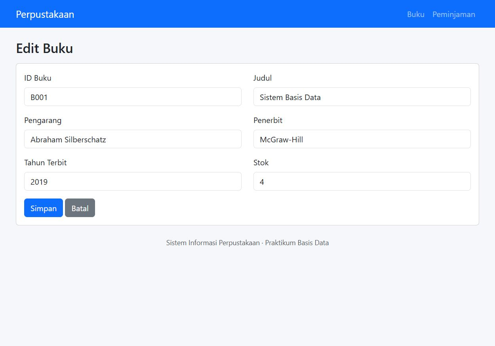
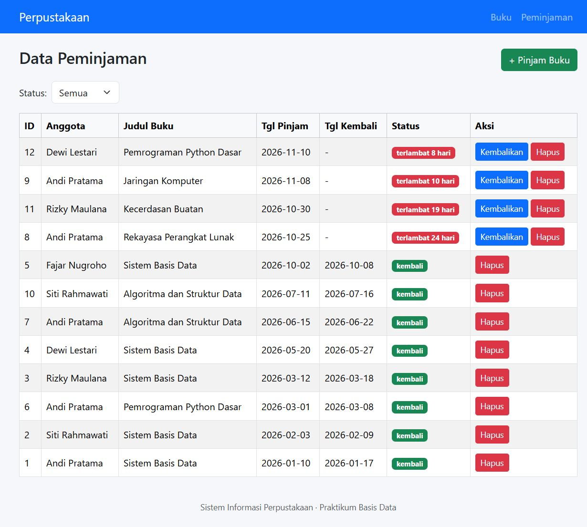

# Sistem Informasi Perpustakaan — CRUD Dasar (Studi Kasus 1)
### Versi Python (Flask)

**Mata Kuliah:** Basis Data — Materi Praktikum CRUD
**Teknologi yang dipilih:** **Python (Flask)** + PyMySQL + MySQL/MariaDB
**Database:** `db_perpustakaan`

## 📌 Identitas Mahasiswa

| | |
|---|---|
| **Nama** | Zaidan Fayyadh Ha'il Daffa |
| **NIM** | 26091397123 |
| **Kelas** | 2026D |

---

Aplikasi CRUD untuk mengelola **buku** dan **transaksi peminjaman** pada sebuah perpustakaan.
Implementasi ini memakai **Flask** dengan pola *routing* berbasis dekorator, **Jinja2** untuk
template (dengan *template inheritance*), dan **PyMySQL** untuk akses basis data.

---

## 1. Konsep CRUD

| Operasi | SQL | HTTP | Penerapan pada aplikasi |
|---------|-----|------|--------------------------|
| **C**reate | `INSERT` | GET/POST | Menambah buku, mencatat peminjaman |
| **R**ead | `SELECT` | GET | Daftar buku (pencarian), daftar peminjaman (JOIN) |
| **U**pdate | `UPDATE` | GET/POST | Mengubah data buku, memproses pengembalian |
| **D**elete | `DELETE` | POST | Menghapus buku, menghapus transaksi |

---

## 2. Struktur Project

```
perpus-flask/
├── app.py                    # titik masuk: create_app() + mendaftarkan blueprint
├── config.py                 # konfigurasi (SECRET_KEY, koneksi DB)
├── db.py                     # membuka/menutup koneksi per request
├── requirements.txt          # daftar dependensi
├── database/
│   ├── db_perpustakaan.sql   # skrip skema + data awal
│   └── tes_crud.py           # pengujian otomatis 16 skenario
├── routes/                   # ===== LOGIKA (Controller) =====
│   ├── __init__.py           # penanda package
│   ├── buku.py               # blueprint CRUD buku
│   └── peminjaman.py         # blueprint CRUD peminjaman
├── templates/                # ===== TAMPILAN (Jinja2) =====
│   ├── base.html             # kerangka halaman + navbar + flash
│   ├── _errors.html          # potongan daftar error validasi
│   ├── buku/
│   │   ├── index.html        # READ
│   │   └── form.html         # CREATE & UPDATE
│   └── peminjaman/
│       ├── index.html        # READ (JOIN)
│       └── form.html         # CREATE
└── static/
    └── css/style.css         # CSS tambahan
```

**Pemisahan tanggung jawab:** logika (folder `routes/`) dipisahkan dari tampilan
(folder `templates/`), berbeda dengan PHP Native yang mencampur keduanya dalam satu file.

---

## 3. Prasyarat

- **Python 3.10** atau lebih baru
- **MySQL / MariaDB** (mis. dari XAMPP) dengan basis data `db_perpustakaan`
- Browser

---

## 4. Cara Menjalankan

### Langkah 1 — Salin folder project
Letakkan folder `perpus-flask` ke lokasi mana pun, misalnya `C:\xampp\htdocs\perpus-flask`.

### Langkah 2 — Nyalakan MySQL
Buka **XAMPP Control Panel** → tekan **Start** pada **MySQL**.
(Apache tidak wajib, karena Flask memakai server bawaannya sendiri.)

### Langkah 3 — Buat basis data
Buka **phpMyAdmin**: <http://localhost/phpmyadmin> → tab **SQL** → tempel seluruh isi
[`database/db_perpustakaan.sql`](database/db_perpustakaan.sql) → **Go**.

Hasilnya:


### Langkah 4 — Siapkan virtual environment & dependensi
Dari dalam folder project:

```bash
cd perpus-flask
python -m venv venv

# aktifkan virtual environment
venv\Scripts\activate        # Windows
source venv/bin/activate     # Linux / macOS

pip install -r requirements.txt
```

### Langkah 5 — Jalankan aplikasi

```bash
flask --app app run --debug
# atau
python app.py
```

Buka browser ke:

```
http://127.0.0.1:5000/
```

### Konfigurasi (opsional)
Jika kredensial MySQL Anda berbeda, set variabel lingkungan sebelum menjalankan:

```bash
set SECRET_KEY=kunci-rahasia
set DB_HOST=localhost
set DB_USER=root
set DB_PASSWORD=
set DB_NAME=db_perpustakaan
```

---

## 5. Peta URL Aplikasi

| Metode | URL | Fungsi | Operasi |
|--------|-----|--------|---------|
| GET | `/buku/` | `buku.index` | Read daftar buku |
| GET/POST | `/buku/tambah` | `buku.tambah` | Create buku |
| GET/POST | `/buku/<id_buku>/edit` | `buku.edit` | Update buku |
| POST | `/buku/<id_buku>/hapus` | `buku.hapus` | Delete buku |
| GET | `/peminjaman/` | `peminjaman.index` | Read transaksi (JOIN) |
| GET/POST | `/peminjaman/tambah` | `peminjaman.tambah` | Create transaksi |
| POST | `/peminjaman/<id>/kembalikan` | `peminjaman.kembalikan` | Update (pengembalian) |
| POST | `/peminjaman/<id>/hapus` | `peminjaman.hapus` | Delete transaksi |

---

## 6. Skema Basis Data

```
anggota                 peminjaman                buku
┌──────────────┐       ┌──────────────────┐      ┌────────────────┐
│ id_anggota PK├──────►│ id_anggota  (FK) │      │ id_buku PK     │
│ nama         │   N:1 │ id_pinjam PK(AI) │      │ judul          │
│ alamat       │       │ id_buku    (FK)  ├─────►│ pengarang      │
│ tgl_daftar   │       │ tgl_pinjam       │  1:N │ penerbit       │
└──────────────┘       │ tgl_kembali      │      │ tahun_terbit   │
                       │ status ENUM      │      │ stok           │
                       └──────────────────┘      └────────────────┘
```

---

## 7. Aturan Bisnis

1. **Stok** = jumlah eksemplar tersedia. Dipinjam → stok −1; dikembalikan → stok +1. Stok `0` tidak dapat dipinjam.
2. **Batas peminjaman 7 hari.** Keterlambatan = `GREATEST(DATEDIFF(CURDATE(), tgl_pinjam) - 7, 0)`.
3. **ID buku berformat `Bxxx`** (contoh `B008`) dan **tidak dapat diubah** setelah tersimpan (primary key).
4. **Buku dengan riwayat peminjaman tidak dapat dihapus** — dijaga otomatis oleh *foreign key* (error MySQL `1451`).

---

## 8. Teknik yang Diterapkan

| Teknik | Penjelasan |
|--------|-----------|
| **Blueprint** | Mengelompokkan route per modul (`routes/buku.py`, `routes/peminjaman.py`) |
| **Template inheritance (Jinja2)** | `base.html` memuat navbar & flash; halaman lain cukup mengisi blok `content` |
| **Escape HTML otomatis** | Jinja2 meng-escape setiap variabel → aman dari **XSS** |
| **Prepared statement (`%s`)** | PyMySQL mengirim parameter terpisah → mencegah **SQL injection** |
| **Validasi di server** | `validasi()` memeriksa input; atribut HTML hanya untuk kenyamanan |
| **Flash message** | `flash()` + `get_flashed_messages()` berbasis session |
| **Transaksi DB** | `FOR UPDATE` + `commit()`/`rollback()` menjaga konsistensi stok |
| **`teardown_appcontext`** | Koneksi ditutup otomatis setelah setiap request |
| **Penanganan error constraint** | `1062` (duplikat), `1451` (FK ditolak) |

### Kode error yang ditangani

| Kode | Nama | Penyebab |
|------|------|----------|
| 1062 | `ER_DUP_ENTRY` | Menambah buku dengan ID sudah ada |
| 1451 | `ER_ROW_IS_REFERENCED_2` | Menghapus buku yang punya riwayat peminjaman |

---

## 9. Skenario Pengujian

| No | Langkah | Hasil yang diharapkan | Status |
|----|---------|----------------------|--------|
| 1 | Buka halaman Buku | Tabel menampilkan 7 buku (B001–B007) | ✅ |
| 2 | Cari kata kunci `munir` | Tampil 2 buku: B003 dan B007 | ✅ |
| 3 | Tambah buku **B008** | Pesan sukses; B008 muncul di tabel | ✅ |
| 4 | Tambah lagi **B008** | Ditolak: *"ID buku sudah digunakan"* (1062) | ✅ |
| 5 | Tambah buku ID **X1** | Ditolak validasi: format harus `Bxxx` | ✅ |
| 6 | Edit B008, stok → 8 | Pesan sukses; ID tidak dapat diubah | ✅ |
| 7 | Hapus **B008** | Pesan sukses; B008 hilang dari tabel | ✅ |
| 8 | Hapus **B001** | Ditolak: punya riwayat peminjaman (1451) | ✅ |
| 9 | Buka halaman Peminjaman | 12 transaksi tampil (INNER JOIN) | ✅ |
| 10 | Filter status `dipinjam` | Hanya transaksi berstatus dipinjam | ✅ |
| 11 | A006 pinjam B007 | Stok B007 turun 7 → 6 | ✅ |
| 12 | Kembalikan transaksi | Status `kembali`, stok kembali 7 | ✅ |
| 13 | Pinjamkan B006 dua kali | Stok 0; B006 hilang dari dropdown | ✅ |
| 14 | Hapus transaksi B006 | Terhapus; stok B006 bertambah 1 | ✅ |

### Uji otomatis

Seluruh skenario di atas diotomatisasi dalam [`database/tes_crud.py`](database/tes_crud.py).
Skrip ini mengirim request HTTP sungguhan ke aplikasi (dengan *session* agar pesan flash
dapat dibaca), memverifikasi isi basis data lewat PyMySQL, dan mengembalikan kode keluar
bukan nol bila ada skenario yang gagal.

```bash
# pastikan server Flask sudah berjalan, lalu (dari terminal lain):
python database/tes_crud.py
```

Hasil terakhir: **16 PASS / 0 FAIL**.

---

## 10. Tangkapan Layar

### 10.1 Basis Data


### 10.2 Modul Buku

| Operasi | Tangkapan layar |
|---------|----------------|
| **Create** |  |
| **Read** (daftar + pencarian) |  |
| **Read** (pesan flash sukses) |  |
| **Update** (kolom ID *readonly*) |  |
| **Delete** ditolak *foreign key* (error 1451) |  |

### 10.3 Modul Peminjaman

| Operasi | Tangkapan layar |
|---------|----------------|
| **Create** (dropdown anggota & buku yang stoknya tersedia) |  |
| **Read** (INNER JOIN + filter status + badge keterlambatan) |  |

---

## 11. Perbedaan dengan Versi PHP Native

| Aspek | PHP Native | Python (Flask) |
|-------|-----------|----------------|
| Rendering | Server (PHP) | Server (Jinja2) |
| Routing | Satu URL = satu file `.php` | Dekorator `@bp.route` |
| Akses DB | PDO | PyMySQL |
| Placeholder | `?` atau `:nama` | `%s` |
| Escape HTML | Manual (`htmlspecialchars`) | Otomatis (Jinja2) |
| Transaksi | `beginTransaction()` | `commit()` / `rollback()` |
| Cara menjalankan | Apache atau `php -S` | `flask run` atau `python app.py` |
| Kelebihan | Mudah di-deploy, tanpa instalasi tambahan | Kode ringkas, struktur rapi, template inheritance |
| Kekurangan | Rawan kode berulang tanpa framework | Perlu virtual environment |

---

## 12. Sumber

Materi praktikum **"CRUD Dasar — Studi Kasus 1: Sistem Informasi Perpustakaan"**,
Mata Kuliah Basis Data, Semester Ganjil 2026/2027.
